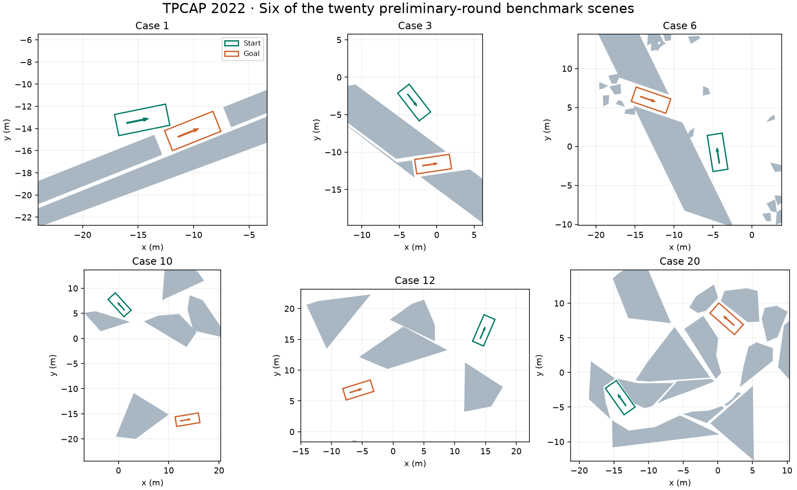

# TPCAP Parking Benchmarks — MATLAB Demo

[Download ZIP](https://github.com/libai1943/TPCAP_demo_Matlab/archive/refs/heads/main.zip) · [Getting started](#quick-start) · [Guide](#file-and-function-guide) · [Citation](#citation)

**Open a parking scene in MATLAB and inspect the exact vertices your collision checker will receive.** This is the original benchmark-loading and visualization demo for the **Trajectory Planning Competition of Automated Parking (TPCAP)**, organized with IEEE ITSC 2022.

TPCAP focused on the planning module: participants submitted trajectories for evaluation without having to implement perception, localization, or vehicle tracking. The preliminary round ran from June 5 to September 12, 2022, and the final round took place on October 10–11, 2022. This repository preserves the **20 preliminary-round scenes** as a reusable research and teaching resource.



Green outlines/arrows mark initial vehicle poses; orange outlines/arrows mark goal poses in this preview. Gray polygons are obstacles. No planned trajectory is implied by the illustration.

## Quick start

Requirements: **MATLAB R2019a or newer** for `readmatrix` and the bundled `Arrow.m` drawing helper. No optimization solver or specialized planning toolbox is needed to display these scenes.

```matlab
cd('C:/path/to/TPCAP_demo_Matlab');
RunMe;
```

The original script opens **20 figures**, one for each benchmark. To inspect one scene, change the loop near the top of `RunMe.m`:

```matlab
for id = 3              % Replace 1 : 20 with a selected case ID
```

Run from the repository root: the current loader resolves `BenchmarkCases` from `pwd` and uses Windows path separators. On another platform, replace the loader path expression with:

```matlab
V = readmatrix(fullfile(pwd, 'BenchmarkCases', ...
    ['Case', num2str(params_.user.case_id), '.csv']));
```

The figures show obstacles, heading arrows, and initial/goal vehicle rectangles. The original MATLAB colors are green for the initial outline and red for the goal outline. The script **does not call a trajectory planner, optimizer, or competition scoring service**.

### Inspect the polygons in the workspace

Set the loop to `for id = 11` and run the script once. Its global structure then holds the five polygons from [Case 11](BenchmarkCases/Case11.csv). The CSV stores 5, 4, 6, 5 and 5 vertices. `LoadCase` appends the first vertex of each polygon so that its contour is closed.

```matlab
global params_
n = cellfun(@(p) numel(p.x)-1, params_.obstacle.obs);
assert(isequal(n, [5 4 6 5 5]))
P = params_.obstacle.obs{3};
vertices = [P.x(1:end-1).' P.y(1:end-1).'];   % six distinct vertices
```

The loop replaces `params_` at each iteration. Inspect a single case as above, or run your own planner inside the loop immediately after `LoadCase()`.

## File and function guide

| File or local function | Purpose |
| --- | --- |
| `RunMe.m` | Entry script; iterate through cases, initialize dimensions, load data, and draw. |
| `InitializeParams` | Set the four vehicle dimensions in global `params_`. |
| `LoadCase` | Decode the flat CSV row into boundary poses and variable-size obstacle polygons. |
| `DrawParkingScenario` | Draw obstacles, headings, and both endpoint footprints. |
| `CreateVehiclePolygon` | Transform the body rectangle from the rear-axle pose into world coordinates. |
| `Arrow.m` | Bundled arrow-drawing utility; see its own embedded documentation and notices. |
| `BenchmarkCases/Case1.csv` … `Case20.csv` | The twenty benchmark inputs. |

The four helper functions are local functions at the end of `RunMe.m`, rather than separate missing `.m` files.

## Benchmark format and coordinate conventions

Each `BenchmarkCases/CaseN.csv` stores a single numeric row:

```text
x0, y0, theta0, xf, yf, thetaf, number_of_obstacles,
vertex_count_1, ..., vertex_count_m,
x_1_1, y_1_1, ..., x_1_n1, y_1_n1,
..., x_m_1, y_m_1, ..., x_m_nm, y_m_nm
```

Positions and vehicle dimensions are in **meters**; headings are in **radians**. The pose reference is the **rear-axle center**. Obstacle vertices are ordered around each polygon. There are no state/control trajectories in these scene files.

The sample vehicle has a 2.8 m wheelbase, 0.96 m front overhang, 0.929 m rear overhang, and 1.942 m width. Its total body length is 4.689 m. The display window is derived from the endpoints; it is not an additional collision boundary encoded in the CSV file.

To build a planner on top of the demo, read the initial/goal poses and obstacles, formulate your vehicle dynamics and collision constraints, then compute and evaluate a trajectory. Plotting a scene does not check feasibility or compute a competition score. The paper is the reference for the historical competition's rules and evaluation; this repository is the scene-loading demonstration.

## Related resources

- [Benchmark archive and case-selection guide](https://github.com/libai1943/TPCAP_benchmarks).

- [Python version of the same scene demo](https://github.com/libai1943/TPCAP_demo_Python).
- [TPCAP GitHub organization](https://github.com/TPCAP).

The 2022 competition has concluded; this archive does not operate a live submission or ranking service.

## Citation

For the benchmark design, competition context, evaluation principles, and reported outcomes, please cite:

> Bai Li, Lili Fan, Yakun Ouyang, Shiqi Tang, Xiao Wang, Dongpu Cao, and Fei-Yue Wang, “Online Competition of Trajectory Planning for Automated Parking: Benchmarks, Achievements, Learned Lessons, and Future Perspectives,” *IEEE Transactions on Intelligent Vehicles*, 8(1), 16–21, 2023. [DOI](https://doi.org/10.1109/TIV.2022.3228963).

```bibtex
@article{Li2023TPCAP,
  author = {Bai Li and Lili Fan and Yakun Ouyang and Shiqi Tang
            and Xiao Wang and Dongpu Cao and Fei-Yue Wang},
  title = {Online Competition of Trajectory Planning for Automated Parking:
           Benchmarks, Achievements, Learned Lessons, and Future Perspectives},
  journal = {IEEE Transactions on Intelligent Vehicles},
  volume = {8}, number = {1}, pages = {16--21}, year = {2023},
  doi = {10.1109/TIV.2022.3228963}
}
```
